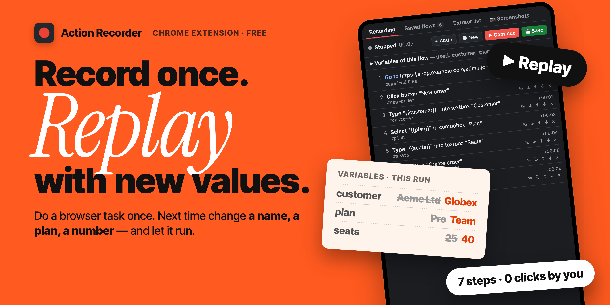
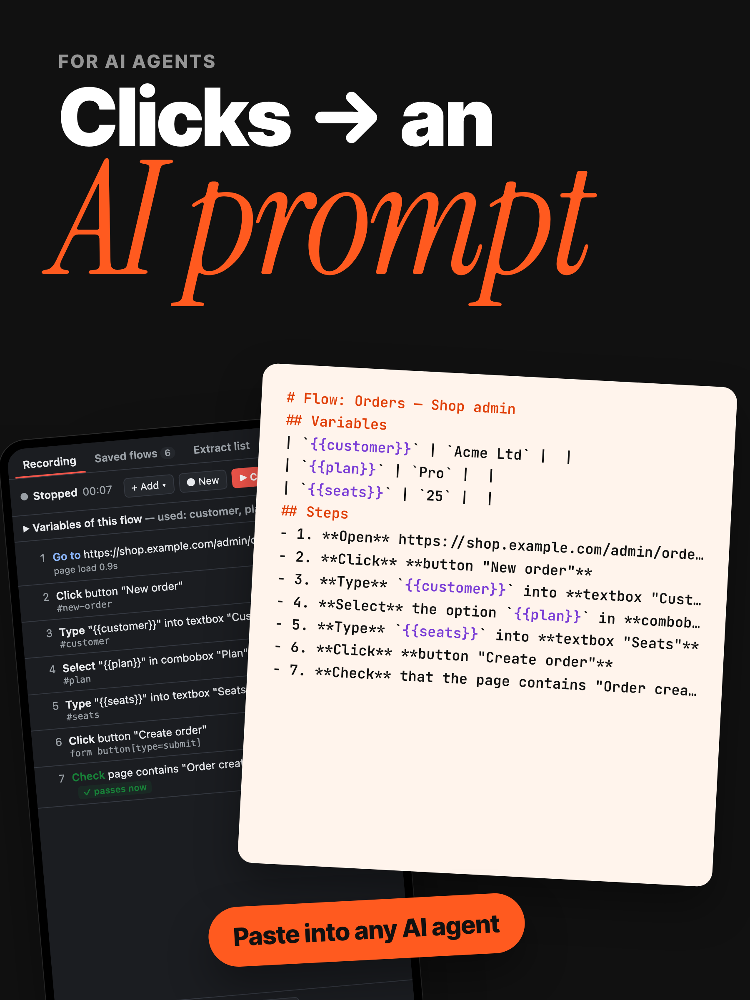
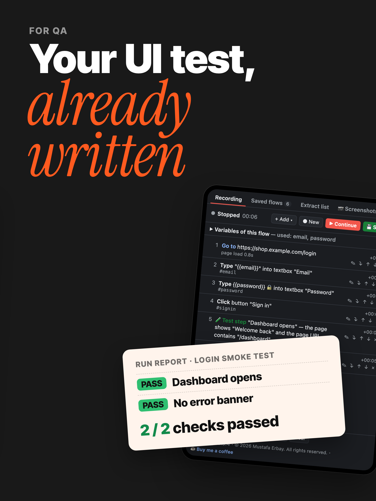
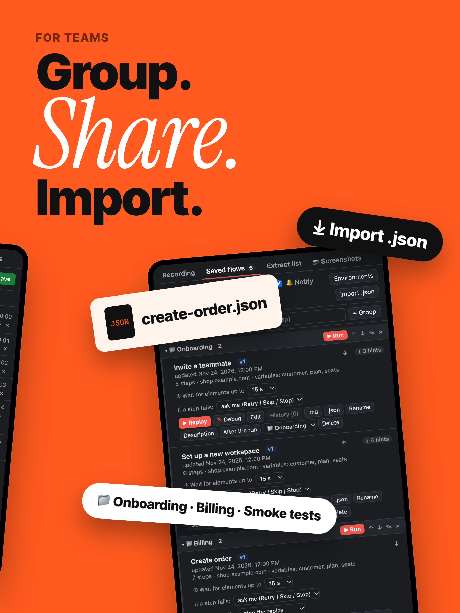

# Action Recorder (Chrome extension)

Record what you do in the browser once — replay it with new values, hand it to an AI agent as a prompt, or keep it as a UI test.

  

  
  
  

<b><a href="https://github.com/mustafaerbay/ActionRecorder/releases/latest">⤓ Download the latest release</a></b> · free · works in Chrome

Records what you do in the browser and exports it as a Markdown step list that an automation agent (e.g. Claude in Chrome) can replay.

The posters above are rendered from the real side panel with sample data: `scripts/posters.sh` (sources in `docs/posters/`).

## Install
1. Download the latest `ActionRecorder-v<version>.zip` from the [Releases](https://github.com/mustafaerbay/ActionRecorder/releases) page and unzip it.
2. Open `chrome://extensions`, turn on **Developer mode**.
3. Click **Load unpacked** and pick the unzipped folder.
4. Pin the extension; clicking its icon opens the side panel.

## Updating
The extension ID is pinned (`jdeoehbmlhkofaijeglffhcnamimmnen`), so saved flows survive updates even if you load a new version from a different folder.
To update: unzip the new version, then in `chrome://extensions` either click ↻ Reload (same folder) or remove the old one and *Load unpacked* the new folder.
Coming from 1.x: export your saved flows as .json first, then import them in 2.x (one time only).
Do not change or remove the `key` field in `manifest.json` — that would change the ID again.

## Use
1. Click **● Start recording** in the side panel, then work in the page as usual.
2. Each action appears live with its active-time offset; pauses ≥ 1.5 s show as yellow **wait** rows, page loads show their load time.
3. Optional: type a note for the agent while recording (e.g. "wait until the pipeline turns green").
4. **❚❚ Pause / ▶ Resume** — skip a part you don't want recorded (e.g. checking another tab). Nothing is captured while paused, and paused time never becomes a "wait" step.
5. Click **■ Stop**, then **Export .md** (agent prompt), **.json** (raw data) or **Copy**.
6. **▶ Continue** (after Stop) keeps adding steps to the same recording. If you are on a different page, a "Continue on <url>" step is added so the agent knows where the flow resumes. **● New** discards it and starts fresh.
7. Paste the Markdown into the agent prompt.

## For agents: the Markdown export
**.md** / **Copy** produce instructions written for an agent: *Before you start* (variables, allowed values), a *Flow
outline*, the rules this flow needs, the numbered steps with labelled If blocks, and *When you are done* (what to
report). Before you hand a flow to an agent, look at its **⚠ Flow check** (flow card or editor) and fix the warnings —
usually by re-recording steps whose elements have no name.

## After the run
**After the run** on a flow card adds requests that are sent when the flow has ended — always, only when it passed, or
only when it failed / was stopped — e.g. a chat message `{"content": "{{FLOW_NAME}}: {{RUN_RESULT}} in {{DURATION}}"}`.
They are sent once the run *ends*: when a step fails the replay first waits for **Retry / Skip / Stop**, so the
requests go out after you answer. For runs nobody watches, set **If a step fails: stop the run and report** on the flow
card — the run then ends at the first failing step (result FAILED) and the requests are sent right away.

## Passwords
Typing into a password field while recording never stores the password: the step gets a 🔒 variable (`{{PASSWORD}}`).
The first time you run the flow, type the password in the run form with **🔑 Remember … on this computer** ticked —
after that it is filled in automatically. Or set it once per environment in **Environments** (🔒 row → type the value).
Saved values are encrypted, stay in this Chrome profile on this computer, and are never exported; **forget** removes one.

## The + Add ▾ menu
While recording (also when paused) and while editing a stopped recording / saved flow, **+ Add ▾** at the top holds
the tools that add steps: **⑂ If**, **✓ Check text**, **⤓ Capture value**, **⏸ Approval**, **🌐 Request**,
**🖱 Add click** and **⟳ For each item** — only the ones that apply right now are listed. (Esc or a click elsewhere
closes it; while a click is being picked the button reads **✕ Cancel click**.)

## Variables, environments and approvals
- **Variables:** write `{{NAME}}` in a step value (✎), or use **→ Make variable** on a recorded value. The flow's defaults are
  in the *Variables of this flow* box. Inside loops `{{item}}` is the current item's name.
- **Environments:** *Saved flows → Environments* — shared sets like DEV / TEST / PROD (e.g. `BASE_URL`, `USERNAME`).
- **Running:** ▶ Replay / 🐞 Debug opens a short form: pick the environment, review or change the values for this run.
- **⑂ If / Else if / Else blocks** are rows in the step list, with the steps of each case indented below them:
  `⑂ If {{TYPE}} is "company"` → steps → `⑂ Else if …` → steps → `⑂ Else` → steps → `⑂ End if`.
  - While recording: **⑂ If** → do the steps → **Else if…** / **Else** → do those steps → **End if**.
  - Closed a block too early, or want to add to another case **while recording**? Press **⤵** on the If / Else if /
    Else row (or on any step): the next recorded steps go there — a blue bar shows where. **Back to the end**
    continues at the end of the flow. **+ Else if** / **+ Else** / **✎** on the If row also work while recording.
  - While editing: **⤵** where the block should go, **⑂ If** → an empty block is added; then add steps into a case with
    **⤵** on its row + **▶ Record here** (or 🌐 / ⏸ / 🖱). On the If row: **✎** condition, **+ Else if**, **+ Else**,
    **×** remove the block (its steps stay). **×** on an Else if / Else row removes that case and its steps.
    **↑ ↓** move a step into or out of a case.
  - A condition looks at a **variable**, the **page text** (e.g. *shows "Sign in"* → log in only when the session
    expired) or the **page URL**. The block is decided once, when the replay reaches the If row: the first true case
    runs, Else only when none did; the other cases are skipped ("– not needed"). Works inside loops (per item).
- **Increase / Decrease / Append:** in ✎ of a typing step choose *What to do* — e.g. *Add to the number in the field*
  with amount `{{STEP}}`: on replay the field's current number is increased by that amount. *Save the new value as
  variable* keeps the result for later steps.
- **🌐 HTTP request:** **🌐 Request** adds a step that calls an API (e.g. POST a message to a chat group). Variables in
  URL / headers / JSON body, expected status, and *Save from the response* (`data.id → ORDER_ID`). Send it *from the
  extension* (any URL, token in headers/body) or *from the current page* (same site, your login).
- **Optional steps:** in ✎ of a click / typing / … step tick **Optional** — if the element is not on the page (e.g. a
  cookie banner that only sometimes appears) the step is skipped instead of failing.
- **🔒 Secrets** (passwords, tokens) are never stored — typed at every run, masked in reports.
- **Required:** tick *Required* next to a variable in *Variables of this flow* when the flow must not run without it
  (e.g. `BASE_URL` from the environment). The run form then blocks **Run** until it has a value.
- **⏸ Approval** steps: *wait for approval* (Approve / Reject) or *ask for a value* during the run (saved as a variable);
  tick *…and type it into a field* + **Pick field** to have the answer typed into a page field automatically.
- While recording you can also type `{{NAME}}` directly into a page field; in the step editor **Insert variable ▾** lists
  all variables the flow knows.
- **⤓ Capture value** (while recording): click an element, choose visible text / field value / attribute, optionally a regex
  such as `#(\d+)`, and save it as e.g. `{{ORDER_ID}}`. Later steps use it; on replay it is read fresh from the page.

## 📷 Screenshot notes (PDF)
Open the **📷 Screenshots** tab, give it a title, then:
1. **▣ Mark an element** → click the element on the page (↑ / ↓ to make the frame bigger / smaller). A screenshot is
   taken with a red numbered frame around it → write the note.
2. **+ mark** on that screenshot to frame more elements of the same screen, or **📷 Whole screen** for a plain screenshot.
3. **⤓ Export PDF** → a summary page with all notes, then one page per screen with its frames and notes.
4. **⤓ Word (.docx)** → the same as a Word document: screenshots with their frames, notes as editable text.
5. **⤓ Markdown (.zip)** → `notes.md` + an `images/` folder, for Git repositories, wikis, Obsidian or VS Code.

Everything stays in your browser (screenshots are kept until **Clear all**); the PDF, Word and Markdown files are made locally.

## Test steps
**+ Add ▾ → 🧪 Test step** adds a named test, e.g. *TC-03 Login shows the dashboard*, with an optional expected result
and conditions that must **all** be true (a variable, a text on the page, the page URL — **+ condition** for more).
Nothing is clicked. The run report starts with a **Test steps** table (✓ PASS / ✗ FAIL and what was seen); a failed
test step is marked and the run continues, or — with *If it fails: stop the run* — waits for Retry / Skip / Stop.
In **After the run** requests use `{{TEST_RESULTS}}` or `{{TEST_TABLE}}`.

## Go back to an earlier step
When a step fails (or the replay waits for you), the steps above it show **↩ from here**. Press it to run again from
that step — it and all steps after it run again, with the variables kept. Not offered inside "For each item" loops.

## Debug a flow (step by step)
In **Saved flows** press **🐞 Debug**. The run pauses before step 1:
- **Step ▸** runs the next step and pauses again · **Continue ⏩** runs until the next breakpoint · **Skip** skips the next step · **Stop**
- Click a step number to set/remove a **breakpoint ●** (saved with the flow; inside a loop it pauses for every item).
- While paused, the element the next step will use is outlined on the page, and the panel says if it was found.

## Edit a saved flow
In **Saved flows** press **Edit** — the flow opens in the Recording tab:
- **✎** change a step (typed text, option, URL, note, check keywords/rules, loop limits, popup answers…)
- **↑ / ↓** move a step, **×** remove it; **▶ Continue** records extra steps at the end
- **⤵ Insert in the middle:** press ⤵ on a step → a red marker shows where new steps go → **▶ Record here**.
  Tip for long flows: first bring the page to the right state — run the flow with **🐞 Debug**, put a breakpoint ● on the step
  after the marker, press Stop when it pauses there, then Edit → ⤵ → ▶ Record here.
- **Update flow** saves a new **version** (v2, v3 …) with an optional "What changed?" note; **Save as new** keeps the original
  and saves a copy.
- Each flow shows its version and last-updated date; **History** lists earlier versions — **Restore** one (it becomes the newest
  version, nothing is lost) or export it as .json.
To change *which element* a step clicks, remove the step and record it again with ▶ Continue.

## Add a click without clicking
**🖱 Add click** (while recording or editing): point at a button and click — the click is blocked and only recorded, so the page
does not react (useful for Delete / Submit / Send). On replay the button is clicked. Note: since the page did not change while
recording, record the following steps on a page that looks like it would after that click (or put it at the end of the flow).

## Check text (keyword verification)
While recording, press **✓ Check text**:
1. Keywords — one per line. Tip: select the text on the page first and it is filled in for you.
2. Choose **must exist** or **must NOT exist**, and how to match: **contains** (default, ignores case), **whole word**, or **regex**.
3. Optional **Pick area** — click the part of the page to check (↑ / ↓ to make it bigger / smaller); otherwise the whole page is checked.
4. **Add check** — it is tested immediately and shown as "passes now" / "fails now".

On replay each check waits up to 8 s for the text, then shows ✓ PASS / ✗ FAIL. In Saved flows choose per flow whether a failed
check **stops the replay** or the replay **continues and reports**; download the **check report** at the end.
A flow of just "open page + checks" works as a quick monitoring check.

## For each item (loops)
For lists where every item must be opened and checked:
1. While recording, press **⟳ For each item** and click one item of the list (all items are outlined and numbered).
2. Record the steps for **one** item: click the item (or its link/button), add **✓ Check text** checks, then go back to the
   list — browser Back, close the popup, or close the tab.
3. Check the options in the blue loop bar and press **End loop**:
   - **Pagination** — the Next / Load-more button found automatically; **Pick Next button** if it is wrong or missing
     (e.g. an icon-only arrow), **No pagination** to stay on the first page, and **Max pages** (default 20).
   - **Max items** (default 100) and **On failure**: next item / stop.

On replay the steps run for every item; after each item the extension returns to the list itself and continues on the next
pages. You get "N items: X passed, Y failed", **Download item results (.csv)** and a check report with one row per item.
One loop level only (no loop inside a loop).

## Extract a paginated list
1. Open the page with the list and go to the **Extract list** tab.
2. **⊞ Pick list item** — hover over the page: all items of the list are outlined in green and numbered. Click one item.
   The panel shows the item count, the detected columns and a preview.
3. **Pagination** — the Next / "Load more" button is found automatically and outlined in orange.
   Use *Pick Next button* if it guessed wrong, or *No pagination*. Set *Max pages* (default 20).
4. **Extract all pages** — the extension clicks through the pages and collects every item (duplicates removed, up to 5000).
   Then **Download .csv**, **.json** or **Copy as Markdown**.

If a recording is running, the extraction is added to it as one step. The agent Markdown then explains how to paginate and
includes the extracted data, and replaying the flow extracts the list again with current data.

## Run reports
After every Replay / Debug run, **Download run report** (Markdown) gives: flow version, mode, start / finish / duration,
environment and variables (secrets as ••••), every step with ✓ / ✗ / ↷ and its note, loop items and all checks.
Item results / extracted data are also available as .csv. Results are kept until you press Close or start another run.

## Save & replay
1. After **■ Stop**, press **💾 Save** (next to ▶ Continue, or at the bottom) and give the flow a name. It appears in the **Saved flows** tab.
2. Press **▶ Replay**. The flow's start page opens in a new tab and the steps run one by one; the panel shows ✓ / ✗ per step.
   - Before each step the replay waits until the element is there and ready: visible, enabled, not covered by a loading
     overlay, and the page has finished loading (no requests in flight). Up to 15 s by default — set
     **⏱ Wait for elements up to** on the flow card for slow systems. Tick *Replay with recorded waits* to also keep your pauses.
   - Native alert/confirm/prompt popups are answered the way you answered them.
   - **Passwords, file uploads and notes pause the replay**: do that part yourself in the page, then press **Continue**.
   - If a step fails (element not found), choose **Retry**, **Skip** or **Stop**.
3. Share a flow with **.json**; others load it with **Import .json**.
4. **Groups & order:** choose a group in a flow's 📁 menu (or **+ Group**), move flows with ↑ ↓, collapse / reorder /
   rename / delete groups in their header. The search box filters by name, description or group.
   **▶ Run** in a group header runs the group as a chain: its flows one after another, one environment, values from
   one flow available to the next, *stop / continue* when a flow fails, and one combined chain report.
5. **Description** on a flow card: say what the flow does and when to run it. It appears on the card, at the top of the
   Markdown export and in run reports.
6. **Export all** saves every flow (with versions and history) and the environments in one backup `.json` — keep it
   as a backup or move everything to another browser with **Import .json** (already-saved flows are skipped; 🔒 secret
   values are never exported).

Keep the side panel open while a flow replays — closing it stops the replay.

**Notifications:** while a replay runs you can work in other windows. A desktop notification tells you when the replay
needs you (approval, a value, a manual step, a failed step, a breakpoint) and when it finishes or stops; click it to jump
to the replay's tab. Switch it off with **🔔 Notify** in *Saved flows*. If nothing appears, check that notifications for
Chrome are allowed in your operating system settings (Windows: *Settings → System → Notifications*; macOS:
*System Settings → Notifications → Google Chrome*).

Replay limitations: the events it sends are synthetic, so a few sites that only accept real user input (some
anti-bot/captcha checks, some canvas/drag editors) may not react. Browser-level shortcuts (e.g. Ctrl+T) are not replayed.

## What is recorded
Clicks, double-clicks, typing (one step per field, when you leave it), dropdown selections, checkboxes/radios, file uploads (names only),
Enter / Escape / shortcut keys, page navigations, in-page (SPA) URL changes and tab switches. Password values are never stored.

**Modals / popups:** actions inside HTML modals are tagged with the dialog's title (e.g. *in dialog "Create user"*).
Native browser popups (`alert`, `confirm`, `prompt`) are recorded with their message and the button you chose or text you typed.
Elements inside web components (open shadow DOM) are recorded too.
**Trees and lists:** when one container handles the clicks of all its items (e.g. a navigation tree with
`tabindex="0"`), the item you clicked is recorded (`item "Order service"`), and the replay finds it by its text even if
the order changed.

Not recorded: scrolling, hovering, drag-and-drop, events inside closed shadow DOM, and browser-level windows that are not part of the page (HTTP basic-auth login, "Leave site?" prompt, print dialog, OS file picker — the chosen file name is still recorded). Remove unwanted steps with **×** before exporting.

## Versioning
The version in `manifest.json` follows `MAJOR.MINOR.PATCH` and is shown in the panel footer. Changes are listed in `CHANGELOG.md`.
- **MAJOR**: breaking change, e.g. the export/JSON format changes, a feature is removed, or new permissions are needed.
- **MINOR**: a new feature that keeps old recordings and exports working.
- **PATCH**: a bug fix or small UI tweak.

## Support
If Action Recorder saves you time, you can [☕ buy me a coffee](https://buymeacoffee.com/mustafaerbay) — the link is also in the panel footer.

---
© 2026 Mustafa Erbay. All rights reserved. Proprietary software — see [LICENSE](LICENSE).
